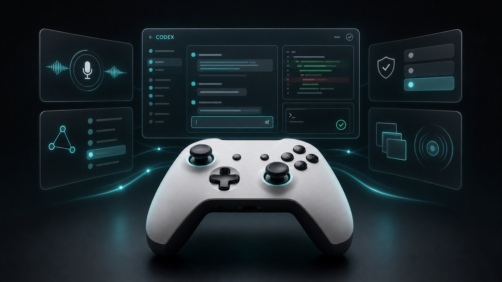
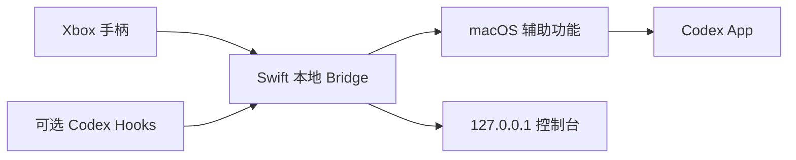

<p align="center">
  
</p>

# Xbox Codex Bridge

用 Xbox 手柄复刻 Codex Micro 的核心交互体验：说话、发送、中止、切换模型与权限，并在任务完成时通过震动把你叫回来。

[English](README.en.md) · [安装](#快速开始) · [完整键位](docs/CONTROLS.md) · [排障](docs/TROUBLESHOOTING.md)

[](CHANGELOG.md)
[](https://github.com/cyq1017/xbox-codex-bridge/actions/workflows/ci.yml)


[](LICENSE)

> **v0.1.0 Preview** — 当前版本面向愿意从源码安装和反馈兼容性的早期用户。它不会修改 Codex App，所有动作都通过 macOS GameController 与辅助功能完成。

## 为什么做这个

键鼠仍然适合写代码，但语音、发送、停止、窗口切换和审批并不需要反复找按钮。Xbox Codex Bridge 把这些高频动作组织成一套可以形成肌肉记忆的实体控制界面。

它不是官方硬件，也不是 Codex Micro 的一比一复制；它是一个本地、可检查、可修改的开源实现。

## 核心能力

| 场景 | 手柄体验 |
| --- | --- |
| 语音 | 按住 LT 说话，松开后写入 Codex；双击可锁定录音 |
| 输入 | RT 短按发送、长按换行，摇杆移动光标和连续选区 |
| 执行 | B 中止任务，十字键查看工作面板与切换任务 |
| 模型 | `RB + A` 打开模型/推理菜单，十字键与 A/B 完成选择 |
| 权限 | `LB + RB + Y` 打开原生权限菜单，不绕过 Codex 二次确认 |
| 多窗口 | View 显示全局 Codex 窗口，`View + X/Y` 新建独立或项目任务 |
| 提醒 | 普通 RT 保持安静；`RB + RT` 发送并在任务完成后震动提醒 |
| 控制台 | `127.0.0.1:8765` 显示连接、映射、辅助功能和设备能力 |

## 快速开始

要求：macOS 13+、Xcode Command Line Tools、Codex 桌面 App，以及 Xbox Wireless Controller 或兼容手柄。

### 交给 Codex 安装（推荐）

在 Codex 中新建一个任务，把下面这段话完整粘贴进去。Codex 会检查环境、解释将要执行的操作，并带你完成需要手动确认的 macOS 权限：

```text
请帮我安装 Xbox Codex Bridge：
https://github.com/cyq1017/xbox-codex-bridge

先阅读 README.md、run.command 和 Scripts 目录，再执行安装。请先告诉我将运行哪些命令、会在本机创建或修改什么，等我确认后再继续。不要使用 sudo，不要修改 Codex App，不要绕过 macOS 的权限确认，也不要把 8765 端口暴露到局域网或公网。安装后运行项目自带的检查，引导我手动开启 Xbox Codex Bridge 的辅助功能权限，并确认控制台、手柄、语音和震动状态。
```

Codex 可以执行构建和诊断，但辅助功能授权必须由你在系统设置中亲自确认。

### 手动安装

```bash
git clone https://github.com/cyq1017/xbox-codex-bridge.git
cd xbox-codex-bridge
./run.command
```

首次运行后：

1. 打开 **系统设置 → 隐私与安全性 → 辅助功能**。
2. 启用安装在 `~/Applications` 中的 **Xbox Codex Bridge**。
3. 再运行一次 `./run.command`，然后打开 `http://127.0.0.1:8765/`。

脚本会安装当前用户的 LaunchAgent，让 Bridge 登录后自动运行。没有 Apple Development 证书时会使用 ad-hoc 签名；重新构建后，macOS 可能要求再次确认辅助功能权限。

## 最常用的键位

| 按键 | 功能 |
| --- | --- |
| Share | 启动或聚焦 Codex；Xbox Logo 被系统占用时的可靠替代 |
| LT 按住/松开 | 开始/停止语音输入 |
| RT 短按/长按 | 发送/换行 |
| B | 中止任务或关闭弹层 |
| Y | 新建任务 |
| 左摇杆 / 右摇杆 | 连续移动光标 / 连续扩展选区 |
| L3 / R3 长按 | 删除选区或前一字符 / 清空输入框 |
| RB + A | 模型与推理强度 |
| RB + RT | 发送并跟踪任务完成震动 |
| LB + RB + Y | 权限模式 |
| View | Codex 窗口选择器 |
| View + X / Y | 新建独立任务 / 从文件夹开始项目任务 |

所有层、菜单操作和文本交互见 [完整键位表](docs/CONTROLS.md)。

## 震动不是每条回复都响

- **任务完成：**只有 `RB + RT` 发送的任务会被跟踪。Codex 确实开始运行并稳定结束后，手柄震动两次。
- **需要审批：**安装可选的 `PermissionRequest` Hook 后，只有真实的允许/拒绝卡片出现时震动三次。
- **普通聊天：**普通 RT 发送、窗口切换和创建任务保持安静。

这避免了每次短对话结束都震动。详细原理和 Hook 配置见 [完整键位与反馈](docs/CONTROLS.md#震动反馈)。

## 工作方式



控制台只绑定 `127.0.0.1`。有副作用的发送、审批和安全动作不能从网页测试，必须由实体手柄触发。

## 验证

自动检查：

```bash
./Scripts/release-check.sh
```

然后按 [v0.1.0 实体手柄清单](docs/releases/v0.1.0-smoke-test.md) 验证语音、发送、中止、模型、权限、窗口与完成震动。

## 文档

- [完整键位与震动规则](docs/CONTROLS.md)
- [安装与常见问题](docs/TROUBLESHOOTING.md)
- [v0.1.0 Preview Release Notes](docs/releases/v0.1.0.md)
- [贡献指南](CONTRIBUTING.md)
- [安全策略](SECURITY.md)

## 当前边界

- Codex Micro 的原生按键事件没有公开接口；LT 通过辅助功能复现输入框中的可见效果。
- Codex 更新可能改变菜单标题或辅助功能结构，需要跟进适配。
- Xbox Logo、Share、震动与灯光能力取决于手柄型号、固件和蓝牙/USB 连接方式。
- 当前是源码优先的 Preview；可直接下载的公证 App 仍需要 Developer ID 与 Apple 公证。

## 开发

```bash
swift test
for test_file in Tests/*.js; do node "$test_file" || exit 1; done
swift build -c release
```

遇到问题时，可以直接使用 [交给 Codex 的诊断提示词](docs/TROUBLESHOOTING.md#交给-codex-诊断推荐)。欢迎提交兼容性报告和小而明确的改进；请注明 macOS、Codex App、手柄型号和连接方式。

## License

使用 [MIT License](LICENSE)。Codex、OpenAI、Xbox 及相关商标归各自权利人所有；本项目与 OpenAI 或 Microsoft 没有隶属或官方合作关系。
